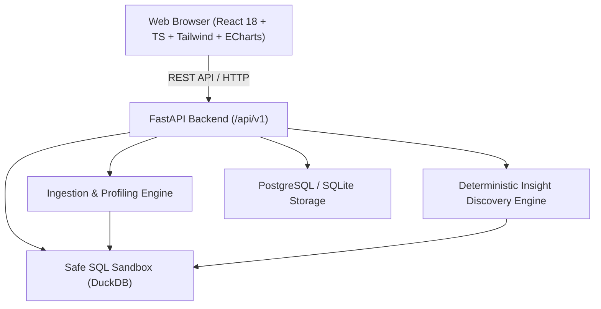

# DATAPRISM: Analytics Workspace

> **See the data. Understand the signal. Make better decisions.**

DATAPRISM brings data ingestion, data quality, SQL exploration, analytics modeling, lineage, interactive dashboards, and evidence-backed insights into one workspace.

---

## 1. System Architecture



---

## 2. Core Capabilities

1. **Data Ingestion Engine:** Conservative schema inference, column normalization, and validation over CSV and Parquet files.
2. **Column Profiling & Quality Scoring:** Real statistics (quantiles, cardinality, missing counts, histograms) and an explainable quality formula (40% Completeness + 30% Validity + 30% Uniqueness).
3. **Safe SQL Workbench:** Fast, in-memory analytical exploration via DuckDB. Prohibits destructive commands (`DROP`, `DELETE`, `UPDATE`, `ATTACH`, multi-statement injections) with query duration telemetry, row limits, and CSV export.
4. **Analytical Modeling & Lineage:** Clean staging, intermediate, and dimensional mart layers with visual dependency graphs.
5. **Governed Metric Catalog:** Explicit grain, calculation SQL, time dimensions, exclusions, and limitations for core business measures.
6. **Interactive Dashboards:** Coordinated ECharts visualizations (Line, Bar, Scatter, KPIs) responding to dynamic market and time filters.
7. **Insight Discovery Feed:** Statistical outlier detection, market concentration signals, and return volume spikes with reproducible SQL evidence queries.
8. **Decision Reports:** Formally structured reports integrating business questions, executive summaries, methodology, findings, and actionable recommendations.

---

## 3. Technology Stack

- **Frontend:** React 18, TypeScript, Vite, Tailwind CSS, Apache ECharts (`echarts`, `echarts-for-react`), Lucide React.
- **Backend:** Python 3.11, FastAPI, Pydantic v2, SQLAlchemy 2.x, DuckDB, Pandas, PyArrow, Uvicorn.
- **Database & Storage:** DuckDB in-process engine, PostgreSQL / SQLite metadata persistence.
- **Testing:** Pytest (100% passing automated API & security sandbox suite).

---

## 4. Quick Start

### Prerequisites
- Python 3.11+
- Node.js v20+

### Setup & Run
```powershell
# 1. Run the unified full-stack application (starts API + Web on port 8050)
python run.py
```
Open **[http://localhost:8050](http://localhost:8050)** in your browser.
API Swagger Documentation is available at **[http://localhost:8050/docs](http://localhost:8050/docs)**.

### Running Tests
```powershell
.\.venv\Scripts\pytest apps/api/tests
```

---

## 5. Demonstration Dataset & Attribution

- **Dataset:** UCI Machine Learning Repository — *Online Retail II*
- **Source:** [https://archive.ics.uci.edu/dataset/502/online+retail+ii](https://archive.ics.uci.edu/dataset/502/online+retail+ii)
- **Description:** Real historical e-commerce non-store transactional records across global customer destinations.
- **Attribution:** The dataset is used strictly for technical benchmarking, analytical modeling, and user evaluation of DATAPRISM. It does not represent active commercial performance.
