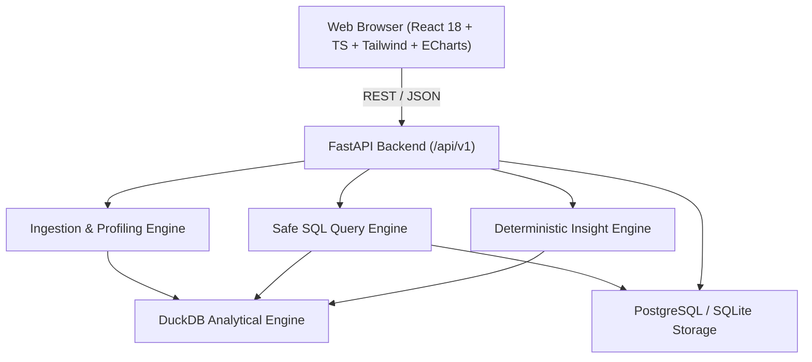

# DATAPRISM: System Architecture

## Architecture Diagram

## Boundaries & Responsibilities
1. **Frontend (`apps/web`):**
   - Single-page application using React 18, TypeScript, Tailwind CSS, Lucide icons, and Apache ECharts.
   - TanStack Query for server state management and caching.
   - Resilient error boundaries and loading states.
2. **Backend (`apps/api`):**
   - FastAPI application providing typed REST endpoints at `/api/v1`.
   - Explicit service and repository layers separating HTTP routing from analytical logic.
   - DuckDB for isolated, fast, sandboxed read-only analytical SQL over Parquet/CSV.
   - SQLAlchemy with SQLite/PostgreSQL for persistent application state (datasets, saved queries, metrics, dashboards, insights, reports).
3. **AI Copilot & Ingestion Provenance:**
   - Dedicated `AIService` supporting deterministic profile interpretations and sandbox-guarded NL-to-SQL.
   - SHA-256 dataset checksums and `IngestionRun` tracking for complete source-to-target provenance.
