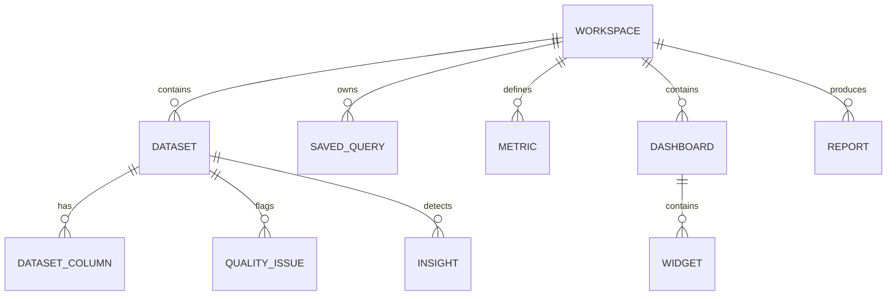

# DATAPRISM: Data Model

## Entities & Relationships

### Core Entities:
- **Workspace:** Isolation boundary for all analytical assets (`id`, `name`, `created_at`).
- **Dataset:** Ingested tabular resource (`id`, `workspace_id`, `name`, `file_path`, `row_count`, `column_count`, `format`, `status`).
- **DatasetColumn:** Profiling metadata (`id`, `dataset_id`, `name`, `data_type`, `null_count`, `distinct_count`, `min_val`, `max_val`, `mean_val`, `distribution_json`).
- **QualityIssue:** Identified validation finding (`id`, `dataset_id`, `severity`, `rule_type`, `column_name`, `message`, `affected_rows`).
- **SavedQuery:** SQL script with creator metadata (`id`, `workspace_id`, `name`, `sql_text`, `created_at`).
- **QueryHistory:** Log of query execution (`id`, `workspace_id`, `sql_text`, `duration_ms`, `row_count`, `status`, `error`).
- **Metric:** Governed metric definition (`id`, `workspace_id`, `name`, `description`, `sql_formula`, `grain`, `unit`, `exclusions`).
- **Dashboard & Widget:** Composable visualization canvases and widget configurations (`type`, `title`, `sql_query`, `chart_config`).
- **Insight:** Statistically verified anomaly or trend (`id`, `dataset_id`, `title`, `description`, `metric`, `baseline`, `observed`, `evidence_query`, `status`).
- **Report:** Formal deliverable combining summary, metrics, widgets, insights, and recommendations.
